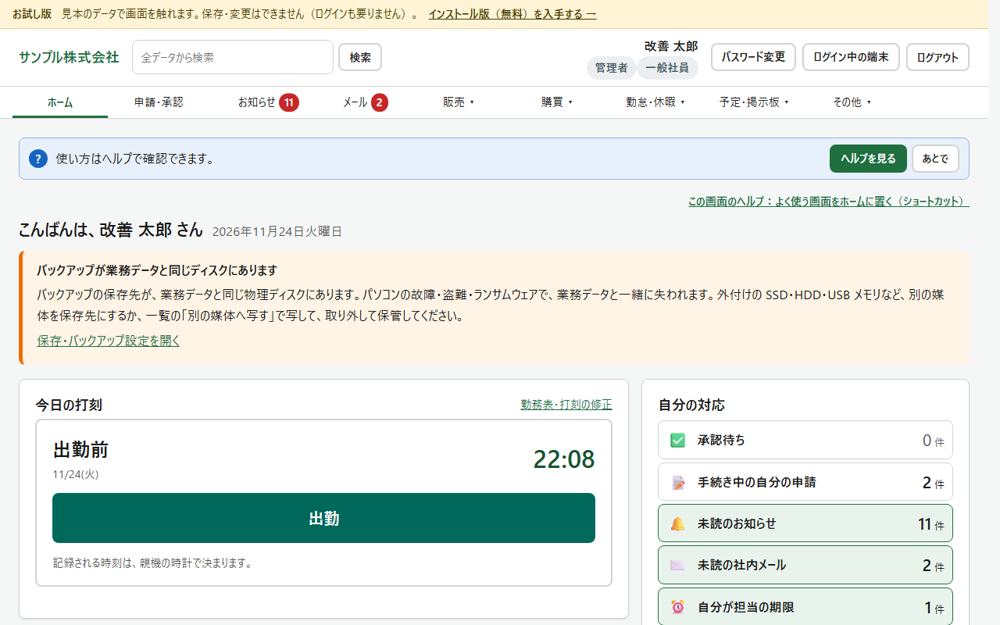
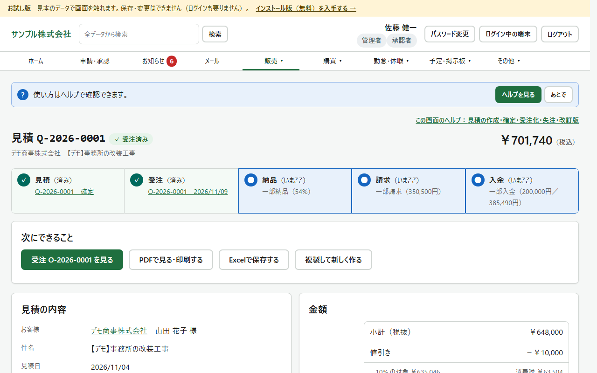
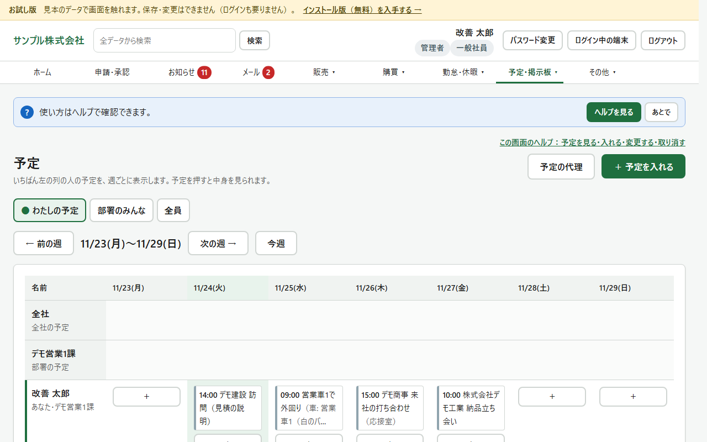

# FreeGroupWare（無償のローカル版）

中小・零細企業向けの業務管理アプリです。**無料**で使えます。
会社の Windows パソコン 1 台（親機）に入れて使います。
同じ社内 LAN にある、ほかのパソコンやスマートフォンからは、ブラウザで使えます。
業務のデータは、親機の中だけに保存します。

この版は、クラウド版として作っていたものから、ローカルで動く部分だけを取り出したものです。
クラウドとの連携、契約、AI の機能はありません（[この版で無くしたもの](#この版で無くしたもの)）。

**お試し版（ブラウザで触れます。ログインも要りません）**
https://algoentertainment-dev.github.io/FreeGroupWare/



**インストール版（無料）のダウンロード**
[Releases](https://github.com/AlgoEntertainment-dev/FreeGroupWare/releases/latest) の `FreeGroupWare_Setup.exe` です。

---

## 目次

1. [できること](#できること)
2. [この版で無くしたもの](#この版で無くしたもの)
3. [動作環境](#動作環境)
4. [使いはじめかた](#使いはじめかた)
5. [データを守る（バックアップと復元）](#データを守るバックアップと復元)
6. [アプリの更新と、戻し方](#アプリの更新と戻し方)
7. [お試し版について](#お試し版について)
8. [利用条件](#利用条件)

---

## できること

画面の上のメニューに出る名前で書いています。
どの機能を使うかは、管理者が「設定」の「使う機能の選択」で決めます。
見られる画面は、利用者の権限（自分／部署／全社）で変わります。

| メニュー | 主な画面 |
| --- | --- |
| ホーム・申請・承認・お知らせ | ホーム、申請・承認（多段・分岐・代理・差戻しができる共通の承認）、お知らせ |
| メール | 社内メール（登録した利用者どうしの連絡） |
| 販売 | お客様、見積、受注、納品、請求書、入金、売上集計、営業日報、定期請求、帳票の社外送信 |
| 購買 | 仕入先、発注、入荷・検収、仕入、買掛・支払予定、資金繰り、支払の記録（支払は記録だけです。振込はしません） |
| 勤怠・休暇 | 勤怠（打刻）、休暇、勤怠の一覧、月の締め、未確認の日、休暇の管理、勤務の型、勤怠の設定 |
| 予定・掲示板 | 予定（代理・参加者）、会議室、掲示板 |
| ものづくり・管理 | 案件、作業工程表、作業時間の記録、在庫、原価・粗利、経費、備品、車両、クレーム、期限通知 |
| 資料 | 共有資料（フォルダ・版の履歴・差し替え・復元）、電子取引データ（電子帳簿保存法の電子取引の保存） |
| 組織 | 社員名簿、部署 |
| 管理 | ユーザー、ログインの安全、予定の代理の一覧、操作履歴、社内メールの監査、検索の索引、ごみ箱、会社のデータの全消去 |
| 設定 | パスワード変更、ログイン中の端末、予定の代理、会社情報、使う機能の選択、業務のつながり、役割と権限、承認設定、お知らせの宛先、社内メールの設定、社外送信の設定、保存・バックアップ設定、接続設定 |
| リンク・ヘルプ | 会社でよく使う Web ページのリンク集、ヘルプ |

そのほかの特徴です。

- 画面の上の検索欄から、見積・請求書・お客様・案件・社内メールなどをまとめて探せます。
  その人が見られるものだけが出ます。
- 上のメニューの大分類は、長押しで並べ替えられます。並びは人ごとに残ります。
- 操作履歴は、あとから書き換えられません。
- 削除したものは、まず「ごみ箱」に入ります。戻せます。
- 会社の外へメールを送るときは、**会社が自分で持っている SMTP サーバー**を使います。
  メールを中継するサービスは使いません。
- 受け取ったファイル（添付・共有資料など）は、決まった入口で検査します。
  形式を確かめ、ウイルスを検査します。
  検査には Microsoft Defender を使います。設定で、ほかの検査用のコマンドに替えることもできます。
  検査できないときは、そのファイルを受け付けません。
- 製品の表示名は、設定ファイル（`config.yaml` の `branding`）を書き換えて再起動すると変わります。

### 画面の例

| 見積（取引の流れが一目で分かります） | 予定（週ごとの予定表） |
| --- | --- |
|  |  |

---

## この版で無くしたもの

無償のローカル版には、次のものはありません。

- クラウドとの連携・ライセンス・月額のプラン
- AI で機能を作る「AI カスタマイズ」と、AI の利用料金
- 自社の台帳（自分で作る台帳）
- ローカルとクラウドの間のデータの移行
- 試用のための環境
- オブジェクトストレージ（クラウドのファイル置き場）
- clamd（Linux 用のウイルス検査器）
- 自動更新（更新のしかたは [アプリの更新と、戻し方](#アプリの更新と戻し方)）

---

## 動作環境

| 項目 | 内容 |
| --- | --- |
| 親機の OS | Windows 10 / 11（64bit） |
| 子機 | 同じ社内 LAN のパソコン・スマートフォン。ブラウザで使います（専用ソフトは要りません） |
| ネットワーク | 社内 LAN。会社の VPN を通して使うこともできます（管理者が許可した接続元だけ） |
| データの保存先 | 親機の中 |

- 待ち受けのポートは、初期設定で `8765` です。
- はじめは、親機だけで使えます（`localhost`）。
  ほかのパソコンから使うには、管理者が「設定」の「接続設定」で社内 LAN への公開を有効にします。
- 社内 LAN の通信は、暗号化（HTTPS）にもできます。自分の認証局（社内用）で証明書を作ります。
- インターネットへ公開しません。ルーターのポート開放もしません。
- 親機のアプリは、通常の権限で動きます。インストールのときだけ、管理者の権限が要ります。

---

## 使いはじめかた

1. インストーラ（`FreeGroupWare_Setup.exe`）を実行します。
2. アプリを起動します。黒い窓（コンソール）が開きます。
   この窓を閉じるとアプリが止まります。最小化しておいてください。
   インストールのときに、Windows へのログオンで自動的に始めるようにもできます。
3. 親機のブラウザで `http://localhost:8765` を開きます。
4. 画面の案内にしたがって、はじめの設定をします。
   - 業務データの保存場所を選びます
   - 会社の情報を入れます
   - 管理者を登録します
5. ほかのパソコンから使うときは、「設定」の「接続設定」で社内 LAN への公開を有効にします。

くわしい使い方は、アプリの「ヘルプ」にあります。

業務データ（データベース・添付ファイル・共有資料・バックアップ）は、アプリのフォルダには置きません。
はじめての起動で選んだ場所に置きます。

---

## データを守る（バックアップと復元）

「設定」の「保存・バックアップ設定」で行います。

- 世代を残すバックアップ（何世代残すか選べます）
- バックアップの内容が壊れていないかの確認
- 試しの復元（本番のデータに触れずに、戻せるかを確かめます）
- バックアップの暗号化（選べます）
- 外付けのドライブなど、親機の外へのバックアップ
- 回復用の秘密の、台の外への保管（親機が壊れても、暗号化したバックアップを開けるようにします）
- 新しい PC への復元（「バックアップから始める」）
- 会社のデータの全消去（パソコンを手放すときなど。権限・再認証・会社名の入力が要ります）

**バックアップは、必ず親機の外にも残してください。**
親機のディスクが壊れると、親機の中のバックアップも一緒に失われます。

---

## アプリの更新と戻し方

自動更新はありません。**新しい版のインストーラを、古い版の上から実行**します。

- 業務データは、アプリのフォルダとは別の場所にあるので、そのまま残ります。
- 新しい版を起動したとき、データベースの形を新しくする作業の前に、データベースの写しを取ります。
  写しは、読んで戻せることを確かめてから使います。
  写せなかったときや、確かめられなかったときは、データベースを変えずに起動を止めます。
  写しは、新しいものから 5 つ残します。
- 新しい版でうまく動かないときは、次の順番で戻します。
  1. アプリを止めます。
  2. 新しい版の `gyomu.exe` を `-rollback-db` を付けて実行します。
     データベースを、更新の前の写しへ戻します。
     戻す前に、いまのデータベースを別の場所へよけます（消しません）。
     写しを選ぶときは `-rollback-file` を使います。
  3. 前の版のインストーラで入れ直します。
  4. アプリを起動して、データを確かめます。

```powershell
gyomu.exe -rollback-db
```

アンインストールしても、業務データは残します。

---

## お試し版について

お試し版は、見本のデータで画面の動きを見るためのものです。

- ログインは要りません。「改善 太郎（管理者）」として開きます。
- 保存・変更・削除はできません。押しても「お試し版のため、保存・変更はできません」と出ます。
- 帳票（PDF）やファイルの取り出しもできません。
- 見本のデータは 2026 年 11 月 24 日の時点のものです。日付や絞り込みを変えても、見本のデータは変わりません。

実際に使うときは、インストール版をお使いください。

---

## 利用条件

アプリは、どなたでも無料で使えます。

ソースコードは公開していません。
アプリを、別のアプリとして配ることや、手を加えて配ることは認めていません。

このアプリは無保証です。使うことで起きた損害について、作者は責任を負いません。
大事なデータは、こまめにバックアップしてください。

アプリに含まれる第三者のソフトウェアとフォントのライセンスは、
インストール先の `docs\THIRD_PARTY_NOTICES.txt` にまとめてあります。
